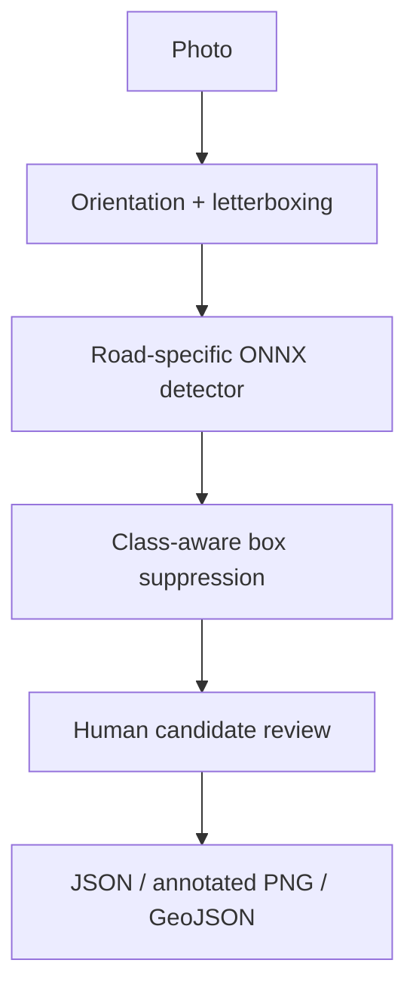

# RoadWatch — Road Damage Inspection Aid

A local computer-vision workflow for detecting candidate pavement cracks and potholes in photos, reviewing boxes and exporting an inspection packet with optional photo-level coordinates.

## Run on a Mac
Python 3.11 or 3.12. Move `roadwatch` to Desktop, then:
```bash
cd ~/Desktop/roadwatch
bash run.sh
```
Open http://localhost:8506 . The app starts without a model download; first inference downloads the pinned road-specific ONNX model (~12 MB). No API key, GPU or PyTorch required.

## First demonstration
1. Enable **Use the licensed public road-photo demo**.
2. Click **Detect road damage candidates**.
3. Inspect the transverse-crack candidate and its box. Mark accepted/rejected only after checking the photo.
4. Download the inspection JSON and annotated PNG.
5. If you know the actual photo location, attach coordinates and export GeoJSON. The sample photo is not assumed to be in your city; no default location is supplied.

Upload your own JPG/PNG/WebP to inspect a different road. Use existing photos or take them from a safe stationary position; the app does not capture from a moving vehicle.

## Implemented
- CPU inference with a pretrained road-specific YOLOv8 ONNX model.
- Four categories: D00 longitudinal crack, D10 transverse crack, D20 alligator crack, D40 pothole.
- Aspect-preserving letterboxing and original-image coordinate recovery.
- Class-aware nonmaximum suppression and adjustable score/IoU cutoffs.
- Candidate review statuses and image/model SHA-256 provenance.
- Optional manually entered photo-level GeoJSON point; no inferred defect GPS.
- AP50/AP50:95 evaluation utility for your own held-out box annotations.
- Tests, Streamlit UI, Mac launcher and CI.

## What is not claimed
No new detector training, independent road-detection accuracy benchmark, physical damage severity, crack depth/width measurement, repair cost, automatic repair prioritization or road-safety certification. A blank result does not show a safe road. Box area depends on camera framing and is not physical severity. Model scores are not calibrated probabilities.

The public model has limited training documentation. Its model card declares MIT while embedded metadata declares AGPL-3.0. Weights are downloaded separately; resolve upstream licensing before commercial redistribution. See MODEL_CARD.md and SOURCES.md. No commercial license conclusion is supplied.

## Architecture


## Evaluate your own held-out dataset
Create a manifest near the images:
```json
{
  "images": [
    {
      "id": "road_001",
      "path": "road_001.jpg",
      "objects": [
        {"class_id": 3, "box_xyxy": [40, 80, 200, 190]}
      ]
    }
  ]
}
```
Class IDs: 0 D00, 1 D10, 2 D20, 3 D40. Boxes are absolute pixel [left, top, right, bottom] in EXIF-oriented images. Include negative images with `objects: []`. Then:
```bash
python evaluate.py path/to/manifest.json
```
Reports are saved to `reports/evaluation.json`. Detection uses a low score cutoff 0.001, NMS IoU 0.45 and maximum 200 predictions/image for ranking evaluation. AP uses 101 recall points and class-aware matching across IoU 0.50..0.95. Classes without positive ground truth are excluded from mAP. This utility is not a replacement for official COCO/RDD challenge tooling. Do not reuse a model's training images as a claimed independent test.

## Verification
Unit tests cover box geometry, letterboxing, output decoding, class-aware suppression, image loading, AP and coordinate order. A real road-photo inference and UI interaction were exercised. The sample is a smoke test, not a road accuracy benchmark. Details are in VERIFICATION.md.

## Reproducibility
`data/model_source.json` pins the upstream repository revision, expected SHA-256 and class map. Downloaded files are hash checked. `requirements-tested.txt` records tested direct dependencies, not all transitive dependencies. `.cache` stores weights and is excluded from git/distribution. No uploaded image is automatically persisted or sent to a hosted inference service.

## Sources and portfolio
The bundled public demo image is CC BY-SA 4.0 with attribution in data/demo_source.json and SOURCES.md. Keep that attribution with redistributed copies. Project presentation and GitHub instructions are in PORTFOLIO_GUIDE.md. The implementation was created with AI assistance; use actual dates and accurately describe your own contributions.
